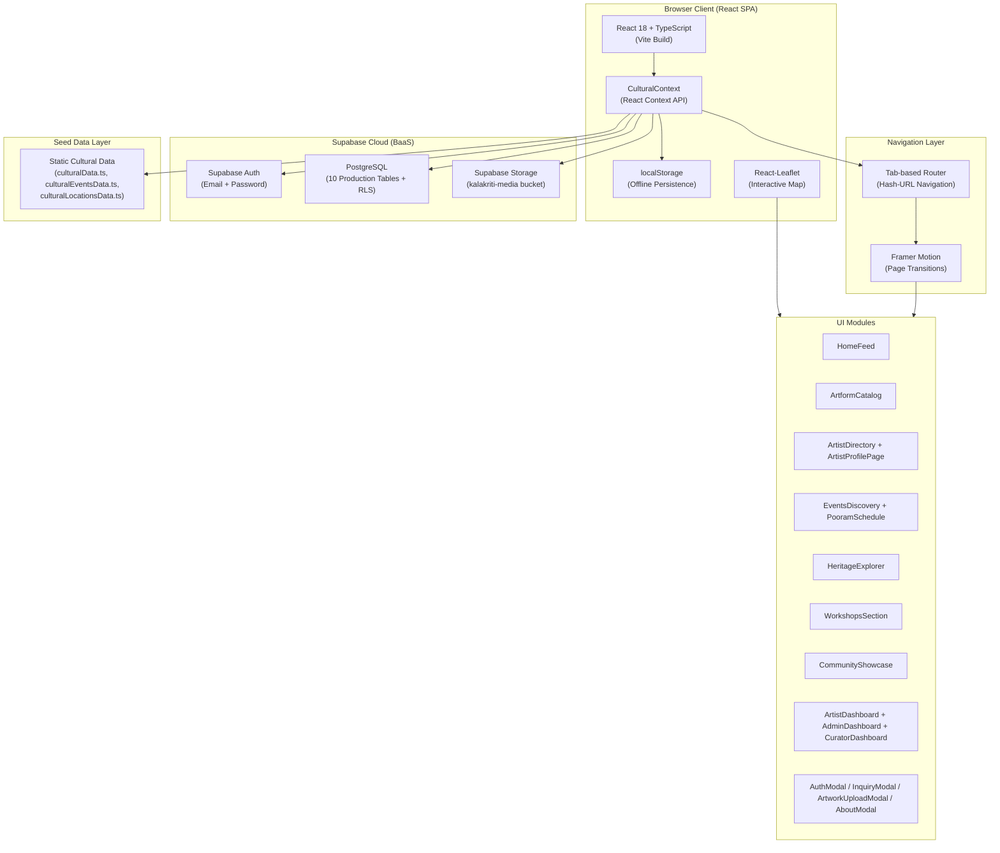
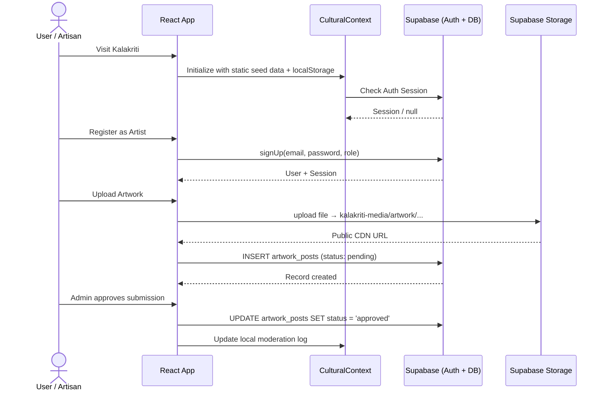
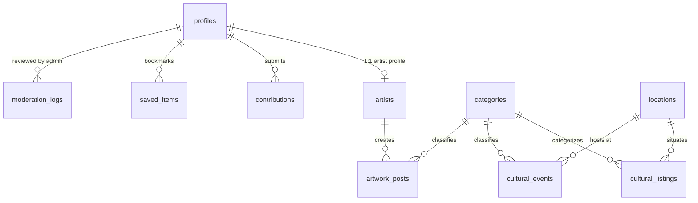
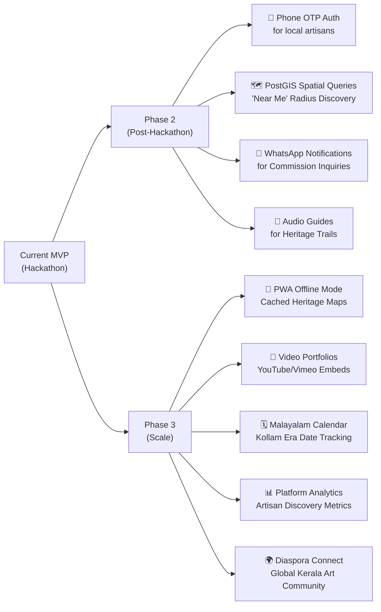

<div align="center">

# 🎭 Kalakriti Kerala
### *കലാകൃതി കേരളം*

**Discover. Preserve. Showcase.**

A community-driven cultural discovery and artist showcase platform for **Thrissur, Kerala** — the Cultural Capital of India.

[](https://reactjs.org/)
[](https://www.typescriptlang.org/)
[](https://vitejs.dev/)
[](https://tailwindcss.com/)
[](https://supabase.com/)
[](https://vercel.com/)

---

*Submitted to: **ART/CODE 2026 Hackathon***

</div>

---

## 1. Project Overview

**Kalakriti Kerala** (കലാകൃതി) is a full-stack, bilingual (English & Malayalam) web platform built to digitally preserve, celebrate, and connect the living cultural heritage of **Thrissur district, Kerala** — officially recognised as the **Cultural Capital of India**.

The platform bridges two worlds that have long remained disconnected: **master artisans and folk performers** who carry centuries of tradition, and **the global audiences, researchers, and patrons** who seek authentic cultural experiences. By giving traditional artists autonomous digital identities — free from intermediaries and exploitation — Kalakriti enables genuine direct connections between creators and appreciators of Kerala's arts.

> [!NOTE]
> The name *Kalakriti* (കലാകൃതി) is a Malayalam compound meaning **"a creation of art"** — symbolising both the act of making culture and the living cultural artefacts it produces.

### Cultural Context — Why Thrissur?

Thrissur (തൃശ്ശൂർ) is home to world-renowned institutions that sustain Kerala's classical performing arts:

| Institution | Significance |
|---|---|
| **Kerala Kalamandalam** (Cheruthuruthy) | World epicentre for Kathakali, Koodiyattam, Mohiniyattam & Thullal |
| **Kerala Sangeetha Nataka Akademi** | Hub for theatre, folk arts & ITFOK |
| **Kerala Lalithakala Akademi** | Patron of fine arts, sculpture & mural tradition |
| **Kerala Sahitya Akademi** | Custodian of Malayalam literature |

Its festivals — most famously *Thrissur Pooram*, "the Mother of all Poorams" — and its GI-tagged crafts (Kuthampully Handloom, Nadavaramba Bell Metal) make Thrissur the most culturally dense district in Kerala.

---

## 2. Problem Statement

| Existing Problem | Kalakriti Solution |
|:---|:---|
| **Fragmented Discoverability** — Cultural events, temple festival lineups, and artisan workshops are communicated via temporary hoardings, WhatsApp groups, or word-of-mouth only. | Unified, real-time cultural calendar with an interactive geolocated map, bilingual content, and filtered event discovery. |
| **Artisan Invisibility & Intermediary Exploitation** — Traditional craftsmen (Kuthampully weavers, Nadavaramba bronze workers) earn low margins while middlemen capture value. | Direct-to-artist showcase with verified profiles, commission inquiry gateways, and zero platform commission. |
| **Loss of Cultural Knowledge** — Rare ritual art forms (*Nangiar Koothu*, *Chavittu Nadakam*, *Kummattikali*) lack structured digital documentation or audio-visual archives. | Living Encyclopedia with taxonomy, historical lineage, and bilingual multimedia documentation. |
| **Linguistic & Accessibility Barriers** — Existing tourism platforms are English-centric and disregard local Malayalam-speaking artisans. | Genuinely bilingual platform (Malayalam ⇄ English) optimised for mobile-first access and low-bandwidth connections. |

---

## 3. Key Features

### 🏠 Home Feed
An editorially curated landing experience featuring highlighted artists, upcoming cultural events, and a live portal into Thrissur's cultural calendar — rendered with smooth Framer Motion page transitions.

### 🎭 Artform Catalog — Living Encyclopedia
A comprehensive, bilingual taxonomy of Thrissur's traditional arts across six categories:
- **Classical Performing:** Kathakali, Koodiyattam, Mohiniyattam, Chakyar Koothu, Nangiar Koothu
- **Percussion & Orchestral:** Panchavadyam, Pandi Melam, Panchari Melam, Thayambaka, Maddalam Keli
- **Folk & Ritual:** Pulikali, Kummattikali, Chavittu Nadakam, Kolkkali, Daffmuttu, Margamkali
- **Crafts & Visual:** Mural Painting, Nadavaramba Bell Metal, Kuthampully Handloom, Kathakali Koppu Making

Each artform entry includes rich history dossiers, instruments used, notable masters, GI-tag and UNESCO recognition badges, and audio pronunciation guides for Malayalam terms.

### 🗺️ Interactive Thrissur Map
A fully functional interactive map (powered by Leaflet/React-Leaflet) pinning:
- 🏛️ Heritage Sites & Museums
- 🎭 Performing Arts Stages & Mandapams
- 🔨 Artisan Workshops & Master Studios
- 🎪 Active Cultural Events & Temple Melams
- 🧵 Handloom & Craft Clusters

The map supports category filtering, taluk-level exploration, and deep-links into cultural location detail pages.

### 👨‍🎨 Artist Directory & Profiles
A searchable, filterable directory of master artisans and performers, each with:
- Bilingual biography and **guru lineage** (parampara)
- High-resolution artwork and performance galleries
- Studio/workshop location, taluk, and contact preferences
- **Verification badge** system: `Verified Master`, `Heritage Guild`, `Emerging Folk Artist`
- Direct Commission/Inquiry modal with WhatsApp integration

### 📅 Events Discovery & Pooram Schedule
- Full festival calendar with upcoming and past events
- Dedicated **Thrissur Pooram Schedule** module with detailed Melam lineups (Panchavadyam, Ilanjithara Melam, Kudamattam, Vedikkettu)
- Dual Gregorian and Malayalam Era (Kollam Era) date tracking
- Event filtering by artform, taluk, and status

### 🏛️ Heritage Explorer
A curated guide to Thrissur's sacred and historic monuments — temples (Vadakkunnathan, Guruvayur), palaces, churches, mosques, craft villages, academies — with visiting hours, dress codes, architectural notes, and audio guides.

### 🧑‍🏫 Workshops Section
Masterclasses and workshops hosted by verified traditional masters, with skill-level classification, seat limits, fee information, and registration links.

### 🖼️ Community Showcase
A moderated gallery where the community submits photographs, field notes, and cultural stories. Supports likes, bookmarking, and multi-image galleries.

### 🎨 Artist Studio Dashboard
Authenticated artists can:
- Manage their public profile, lineage, and contact preferences
- Upload artworks with multi-image galleries, craft technique descriptions (medium, dimensions, price)
- Create and manage workshops
- View incoming commission inquiries and leads

### 🛡️ Curator & Admin Dashboard
Cultural board curators and administrators can:
- Review a pending verification queue for new artist/artisan submissions
- Approve, reject, or request changes on submitted artworks, events, and community stories
- Maintain a full **moderation audit log** with timestamped actions

### 🌐 Bilingual Interface
A real-time language toggle (English ⇄ Malayalam) built into the navigation, with Malayalam rendering using the `Noto Serif Malayalam` and `Manjari` font families for precise conjunct glyph support.

### 🔐 Authentication (Supabase)
- Email & password registration/login via Supabase Auth
- Role-based access: `visitor` → `registered_user` → `artist` → `admin`
- Session persistence via `localStorage` with Supabase Auth state sync
- Graceful offline/demo mode when Supabase is not yet configured

---

## 4. Technology Stack

### Frontend
| Technology | Version | Purpose |
|---|---|---|
| **React** | `18.3.1` | UI component framework |
| **TypeScript** | `5.4.5` | Type-safe development |
| **Vite** | `5.2.13` | Build tool & dev server |
| **Tailwind CSS** | `3.4.4` | Utility-first styling |
| **Framer Motion** | `11.2.10` | Hardware-accelerated animations & page transitions |
| **Lucide React** | `0.383.0` | Icon system |
| **clsx + tailwind-merge** | `2.x` | Conditional class utility |

### Mapping
| Technology | Version | Purpose |
|---|---|---|
| **Leaflet** | `1.9.4` | Open-source interactive map rendering |
| **React-Leaflet** | `4.2.1` | React bindings for Leaflet |

### Backend & Database
| Technology | Version | Purpose |
|---|---|---|
| **Supabase** | `2.119.0` | PostgreSQL database, Auth, and Storage |
| **PostgreSQL** (via Supabase) | `15+` | Relational data store with Row Level Security |
| **Supabase Storage** | — | Media bucket (`kalakriti-media`) for artwork & event images |

### Design System
| Element | Detail |
|---|---|
| **Display Font** | Rozha One, Cinzel, Marcellus (serif) |
| **UI Font** | Plus Jakarta Sans, Inter (sans-serif) |
| **Malayalam Font** | Noto Serif Malayalam, Manjari |
| **Colour Palette** | Traditional Red `#A71903`, Terracotta `#BB6D25`, Warm Sand `#C98C4D`, Cream Gold `#ECCA8A`, Parchment `#FAF7F0`, Deep Brown `#432813` |

### Deployment & Infrastructure
| Technology | Purpose |
|---|---|
| **Vercel** | Hosting & CI/CD (SPA with rewrite rules) |
| **Supabase Cloud** | Managed PostgreSQL + Auth + Storage |
| **GitHub** | Source control & PR-based deployments |

---

## 5. System Architecture



### Data Flow



### Database Schema Overview

The production database (Supabase PostgreSQL) uses **10 core tables** with Row Level Security (RLS) on every table:



> [!IMPORTANT]
> All publicly readable content is guarded by an RLS policy requiring `status = 'approved'`. Unauthenticated visitors can only see curator-approved records.

### Role-Based Access

| Role | Browse | Bookmark | Submit Content | Manage Artists | Moderate |
|:---|:---:|:---:|:---:|:---:|:---:|
| **Visitor** | ✅ (approved only) | ❌ | ❌ | ❌ | ❌ |
| **Registered User** | ✅ | ✅ | ✅ (pending) | ❌ | ❌ |
| **Artist** | ✅ | ✅ | ✅ | ✅ (own) | ❌ |
| **Admin / Curator** | ✅ (all statuses) | ✅ | ✅ | ✅ | ✅ |

---

## 6. Installation & Setup Instructions

### Prerequisites

| Requirement | Version |
|---|---|
| Node.js | `>= 18.x LTS` |
| npm | `>= 9.x` (bundled with Node.js) |
| Supabase Account | [supabase.com](https://supabase.com) (free tier works) |

### Step 1 — Clone the Repository

```bash
git clone https://github.com/<your-org>/kalakriti-kerala.git
cd kalakriti-kerala
```

### Step 2 — Install Dependencies

```bash
npm install
```

### Step 3 — Configure Environment Variables

```bash
# Copy the template
cp .env.example .env.local
```

Then edit `.env.local` with your Supabase credentials (see [§7 Environment Variables](#7-environment-variables)).

### Step 4 — Set Up the Supabase Database

Apply the schema and seed data using the Supabase CLI or the SQL Editor:

```bash
# Option A — Supabase CLI (recommended)
npx supabase login
npx supabase link --project-ref <your-project-id>
npx supabase db push

# Option B — Direct SQL execution (seed data)
psql -h db.<your-project-id>.supabase.co -U postgres -d postgres \
     -f supabase/migrations/20261107000000_kalakriti_schema.sql
psql -h db.<your-project-id>.supabase.co -U postgres -d postgres \
     -f supabase/seed.sql
```

> [!NOTE]
> The seed file (`supabase/seed.sql`) includes cultural categories, Thrissur taluks, 6 master artist profiles, and 15 curated cultural listings to get started immediately.

### Step 5 — Create the Storage Bucket

In the **Supabase Dashboard → Storage**, create a **public bucket** named:

```
kalakriti-media
```

### Step 6 — Run the Development Server

```bash
npm run dev
```

The application starts at **http://localhost:3000**

### Step 7 — Build for Production

```bash
npm run build
```

The optimised static output is generated in the `dist/` directory.

### Step 8 — Preview the Production Build

```bash
npm run preview
```

---

## 7. Environment Variables

All environment variables are prefixed with `VITE_` so Vite exposes them to the browser client.

Create a `.env.local` file at the project root (never commit this file — it is listed in `.gitignore`):

```env
# ============================================================================
# KALAKRITI — Environment Variables
# Copy from .env.example and populate with your Supabase project credentials.
# NEVER expose service_role keys or database passwords in client-side code!
# ============================================================================

# Supabase Project URL (Public — safe for browser)
VITE_SUPABASE_URL="https://your-project-id.supabase.co"

# Supabase Anon Key (Public — enforced by Row Level Security)
VITE_SUPABASE_ANON_KEY="your-supabase-anon-key-here"

# Application Base URL
VITE_APP_URL="http://localhost:3000"
```

| Variable | Description | Required |
|---|---|---|
| `VITE_SUPABASE_URL` | Your Supabase project URL (from Project Settings → API) | ✅ Yes |
| `VITE_SUPABASE_ANON_KEY` | Supabase public anonymous key (safe for client-side use; protected by RLS) | ✅ Yes |
| `VITE_APP_URL` | Base URL of your deployed application | Optional |

> [!CAUTION]
> **Never** expose the `service_role` key or database passwords in environment variables accessible to the browser. The `anon` key is designed for client-side use and is kept secure by Row Level Security policies on the database.

> [!TIP]
> The app includes a graceful **offline/demo mode**: if Supabase credentials are absent or placeholder values are detected, all data is served from static seed files and localStorage, so you can explore the full UI without a live database connection.

---

## 8. Usage Instructions

### For Visitors (No Account Required)
1. Open the application — the **Home Feed** loads with featured artists and upcoming events.
2. Navigate using the **top navbar** (desktop) or **bottom tab bar** (mobile).
3. Browse the **Artform Catalog** to explore traditional Thrissur arts with bilingual descriptions.
4. Open the **Interactive Map** to discover heritage sites, artisan studios, and festivals by location.
5. Visit the **Artist Directory** to find master artisans, view their portfolios, and read their lineage.
6. Check the **Events** and **Pooram Schedule** sections for the cultural calendar.
7. Toggle between **English and Malayalam** using the language switcher in the navbar.

### For Registered Users
1. Click **Sign In / Register** in the navbar to create an account.
2. After login, **bookmark** artists, artworks, and heritage locations using the ♥ / 🔖 icons.
3. Submit cultural listings and events (they enter the curator review queue before going live).

### For Artists
1. Register an account and select the **Artist** role during sign-up.
2. Access the **Artist Dashboard** to build your public profile:
   - Add your stage name, bio (English & Malayalam), guru lineage, and studio location.
   - Upload artworks with multi-image galleries, craft technique notes, dimensions, and price.
   - Create and publish workshops.
3. Receive commission inquiries through the **Inquiry Modal** on your public profile.
4. Apply for the **Verified Master** badge (reviewed by the Cultural Board Curator).

### For Administrators / Curators
1. Log in with an admin account (or use the **Demo Admin Login** button for hackathon evaluation).
2. Navigate to the **Admin Dashboard** (accessible via the navbar when logged in as admin).
3. Review the **Moderation Queue** — approve, reject, or request changes on pending submissions.
4. All moderation actions are recorded in the **Audit Log** with timestamps and admin identity.

### Demo Admin Access
For hackathon judges, a one-click **Demo Admin Login** is available directly in the Auth modal. This logs in as `Dr. Radhika Nair (Chief Curator)` with full admin privileges for demonstration purposes.

---

## 9. Demonstration Screenshots

> [!NOTE]
> Replace the placeholder blocks below with actual screenshots before final submission.

### Home Feed & Hero Section
```
[ Screenshot: Home Feed — Featured Artists, Upcoming Events Banner, Language Toggle ]
```

### Artform Catalog — Living Encyclopedia
```
[ Screenshot: Artform Catalog grid with Kathakali, Panchavadyam, Pulikali cards, bilingual labels ]
```

### Interactive Thrissur Map
```
[ Screenshot: Leaflet map of Thrissur with cultural marker pins, category filter pills active ]
```

### Artist Directory & Profile Page
```
[ Screenshot: Artist Directory grid with verification badges, search bar, taluk filter ]
[ Screenshot: Individual Artist Profile — gallery, lineage, Inquiry CTA button ]
```

### Artist Studio Dashboard
```
[ Screenshot: Artist Dashboard — artwork upload modal, portfolio management, workshop creator ]
```

### Events Discovery & Pooram Schedule
```
[ Screenshot: Cultural Events calendar with upcoming Pooram listing and Melam lineup details ]
```

### Heritage Explorer
```
[ Screenshot: Heritage Explorer — Vadakkunnathan Temple card with visiting hours and dress code ]
```

### Community Showcase
```
[ Screenshot: Community Showcase multi-image gallery with like counts and category filters ]
```

### Admin / Curator Dashboard
```
[ Screenshot: Admin Dashboard — Moderation Queue with pending submissions, approve/reject controls ]
[ Screenshot: Moderation Audit Log with timestamped action history ]
```

### Mobile Responsive View
```
[ Screenshot: Mobile bottom navigation bar — Home, Map, Upload FAB, Artists, Events tabs ]
```

---

## 10. Team Members

> [!NOTE]
> Replace the placeholders below with actual team member details before final submission.

| Name | Role | Contribution |
|---|---|---|
| `[Team Member 1 — LEYA JAMES ]` | `[Role, e.g. Full-Stack Developer]` | `[e.g. Core architecture, Supabase integration, ArtformCatalog, InteractiveMap]` |
| `[Team Member 2 — HRISHIKESH TM]` | `[Role, e.g. Frontend Developer & UI Designer]` | `[e.g. Design system, Tailwind theme, ArtistDirectory, ArtistDashboard, Framer Motion animations]` |
| `[ LEYA JAMES ]` | `[Role, e.g. Backend Developer & DB Architect]` | `[e.g. Supabase schema, RLS policies, seed data, storage pipeline, AdminDashboard]` |
| `[ HRISHIKESH TM]` | `[Role, e.g. Cultural Researcher & Content Lead]` | `[e.g. Artform taxonomy, bilingual content (Malayalam translations), cultural accuracy review]` |

**Institution / College:** `[CHRIST COLLEGE OF ENGINEERING ,IRIJALAKUDA]`
**Team Name:** `[TEAM : VARNIKA]`
**Hackathon:** ART/CODE 2026

---

## 11. Limitations & Future Scope

### Current Limitations

| Area | Limitation |
|---|---|
| **Authentication** | Implements email/password auth via Supabase. Phone OTP (SMS via Fast2SMS/Twilio) for local artisans is designed but not yet integrated. |
| **Geospatial** | Interactive map displays static seed coordinates. PostGIS `ST_DWithin` radius-based queries and "Near Me" detection require backend API routes (designed in TRD but not deployed in this MVP). |
| **Media Pipeline** | Image uploads are stored in Supabase Storage. Automated AVIF/WebP transcoding, responsive `srcset` breakpoints, and watermarking are planned for a future CDN integration (Cloudinary/R2). |
| **Offline / PWA** | Service Worker caching and offline Heritage Trail maps are on the roadmap; not yet implemented in this release. |
| **Multilingual Content** | The UI language toggle (EN ⇄ ML) is fully functional. Full database-level bilingual content (all artist bios, descriptions in both languages) depends on curator-submitted translations. |
| **Real-time Notifications** | In-app and WhatsApp commission notifications are architecturally defined. Currently, inquiries are stored in Supabase but push notifications are not yet wired. |

### Future Scope



**12-Month KPI Targets:**
- 750+ verified master artisans registered
- 100,000 Monthly Active Users
- 100 documented artforms & 300 heritage sites
- 3,000+ commission/workshop inquiries generated
- 500,000 Thrissur Pooram live schedule page views

---

## 12. License & Attribution

### License

> [!IMPORTANT]
> A formal open-source license has **not yet been selected** for this project. All rights are currently reserved by the development team. Please contact the team for usage permissions.

If a license is selected, it will be declared here (e.g., MIT, Apache 2.0, or a Creative Commons variant for cultural content).

### Third-Party Libraries & Attributions

| Library / Resource | License | Usage |
|---|---|---|
| [React](https://reactjs.org/) | MIT | UI Framework |
| [Vite](https://vitejs.dev/) | MIT | Build Tool |
| [Tailwind CSS](https://tailwindcss.com/) | MIT | Styling |
| [Framer Motion](https://www.framer.com/motion/) | MIT | Animations |
| [Leaflet](https://leafletjs.com/) | BSD-2-Clause | Interactive Map |
| [React-Leaflet](https://react-leaflet.js.org/) | Hippocratic License | Leaflet React bindings |
| [Supabase JS](https://supabase.com/) | MIT | Backend Client |
| [Lucide React](https://lucide.dev/) | ISC | Icons |
| [clsx](https://github.com/lukeed/clsx) | MIT | Class utility |
| [tailwind-merge](https://github.com/dcastil/tailwind-merge) | MIT | Class merging |
| [OpenStreetMap](https://www.openstreetmap.org/) | ODbL | Map tile data |
| [Google Fonts — Noto Serif Malayalam](https://fonts.google.com/noto/specimen/Noto+Serif+Malayalam) | SIL Open Font License | Malayalam typography |
| [Google Fonts — Manjari](https://fonts.google.com/specimen/Manjari) | SIL Open Font License | Malayalam body text |

### Cultural Acknowledgement

Kalakriti Kerala is built in deep respect for the living traditions, masters, and communities of Thrissur district. All cultural content — artform descriptions, historical lineages, and heritage documentation — has been developed with care for accuracy and cultural sensitivity. We acknowledge the **Kerala Kalamandalam**, **Kerala Sangeetha Nataka Akademi**, **Kerala Lalithakala Akademi**, and the countless unnamed artisans and percussionists whose lifetimes of practice keep these traditions alive.

> *"Nritham, Vadyam, Geetham — the dance, the percussion, the song. These are not performances. They are prayers."*

---

<div align="center">

Made with ❤️ for Kerala's living cultural heritage · ART/CODE 2026

**Discover. Preserve. Showcase.**
*കണ്ടെത്തുക. സംരക്ഷിക്കുക. പ്രദർശിപ്പിക്കുക.*

</div>
